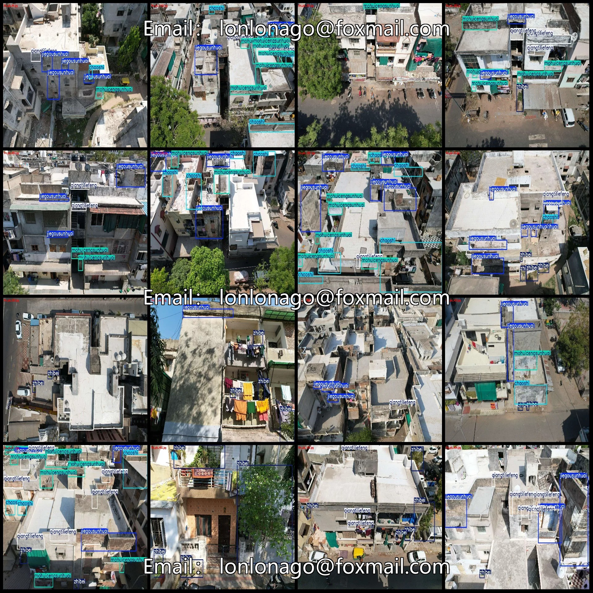
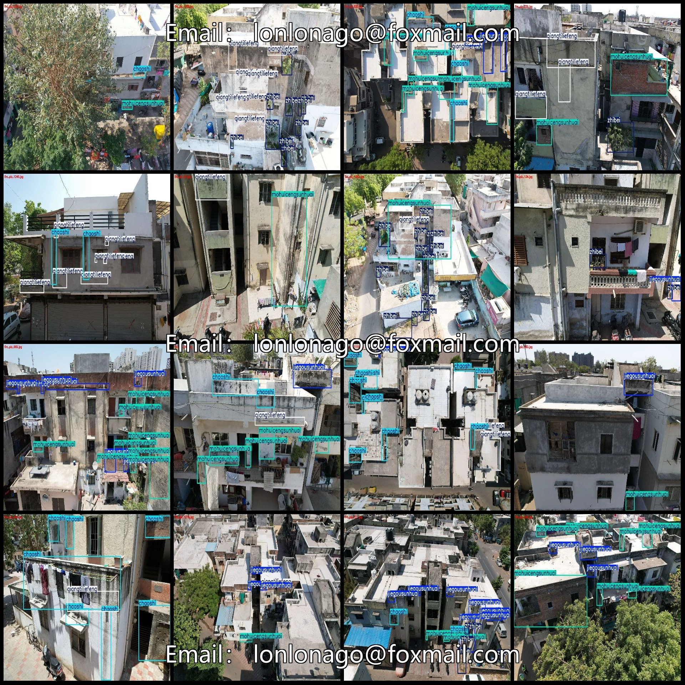
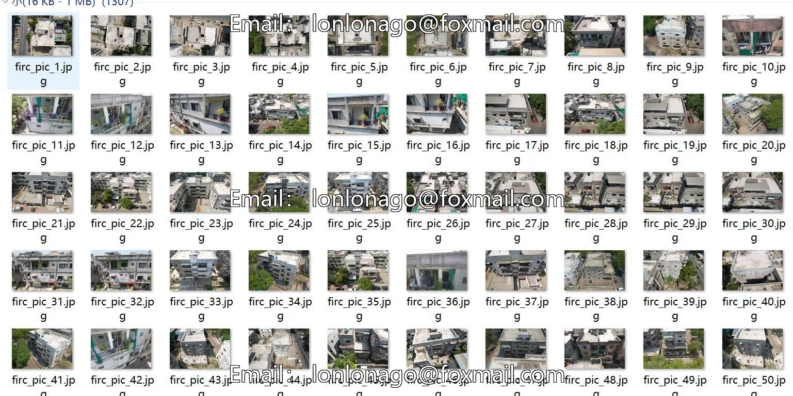
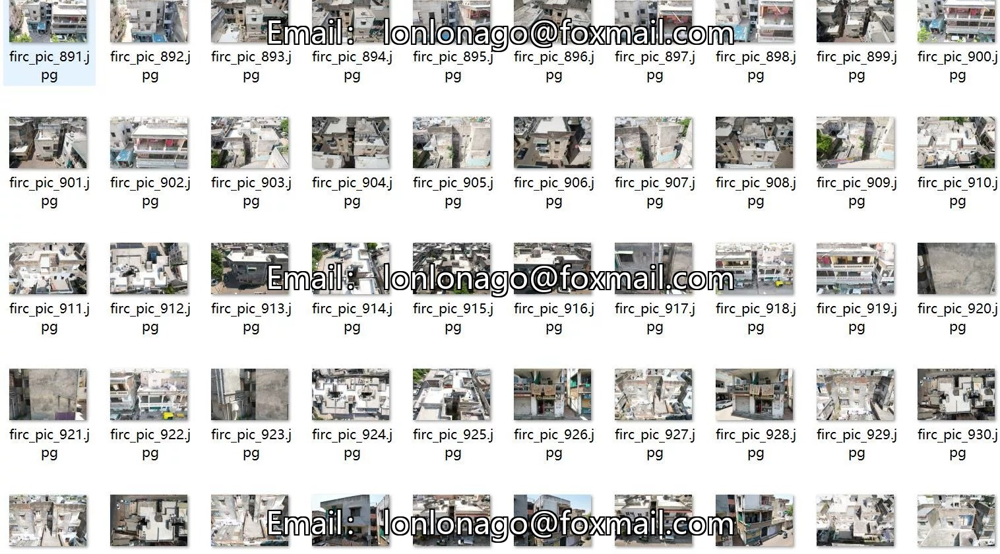
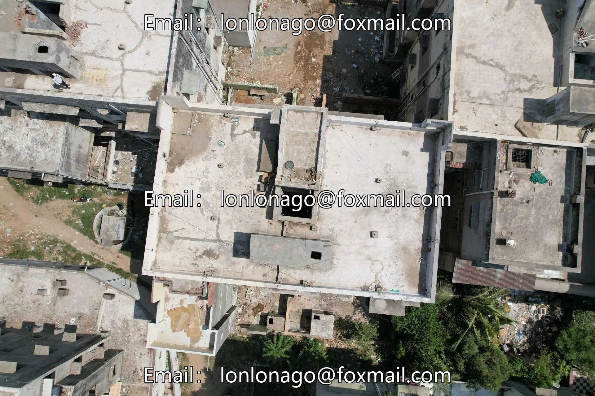
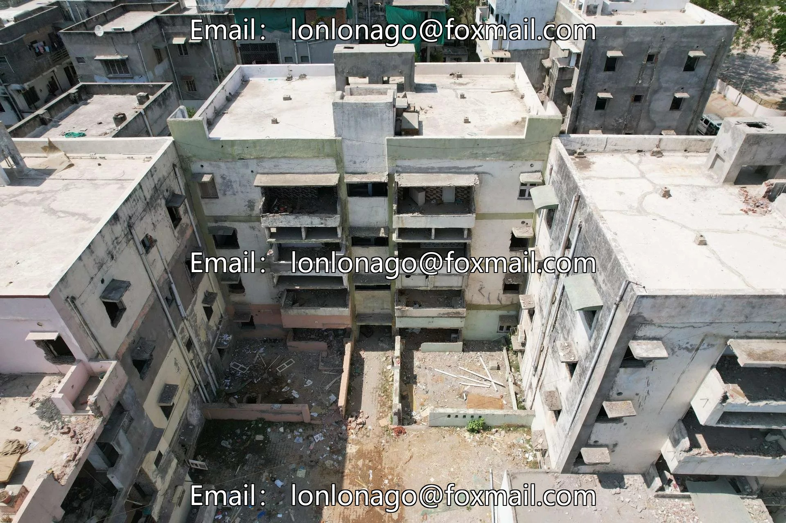
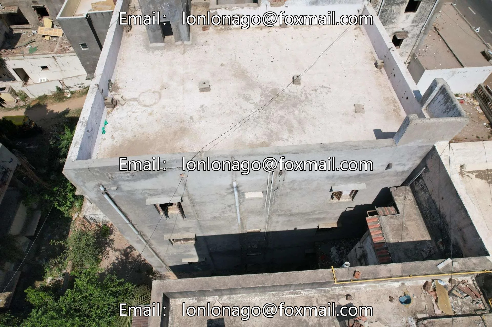

# UAV perspective aerial photography of building facade flaws and housing quality inspection dataset VOC+YOL

## Body

Drone-view aerial photography dataset for building facade defects and housing quality inspection - VOC+YOLO format with 1304 images in 5 categories
Please note: Due to the dataset's replicability, after purchase, please confirm compliance before purchasing.
Dataset format: Pascal VOC format + YOLO format (txt file without split path, only containing jpg images along with corresponding VOC format xml files and yolo format txt files)
Number of images (number of jpg files): 1304
Number of annotations (number of xml files): 1304
Number of annotations (number of txt files): 1304
Number of annotation categories: 5

Label category names (Note that the order of categories in the YOLO format does not correspond to this, but is based on the labels folder's classes.txt): ["chaoshi", "jiegousunhuai", "mohuicengsunhuai", "qiangtiliefeng", "zhibei"]
Corresponding Chinese category name: ["Moisture", "Structural Damage", "Finish Cracks", "Wall Cracks", "Vegetation"]
Number of boxes and the number of images occupied by each category
Frames = 1984, Pictures = 611
Jieguosunhuai Frames = 1758, Pictures Taken = 761

mohuicengsunhuai Frames = 2490, Image Count = 818
qiangtiliefeng Frames = 1801, Image Count = 655
zhibei Frames = 1020, Image Count = 390
Total Frames: 9053
Image Resolution: 1920x1280
Labeling Tool: labelImg
Labeling Rules: Draw a rectangle around the category.
Important Notice: The dataset does not have separate training, validation, and test sets; you need to manually divide them.
Special : This dataset does not guarantee the accuracy of the trained models or weight files.

## Images

## Payment

Here is a pay link on Stripe ( https://buy.stripe.com/3cs8yP7sY87d0vu9AB ). Please contact me lonlonago@foxmail.com after funding $89, and I will send you a complete data files , thank you!

